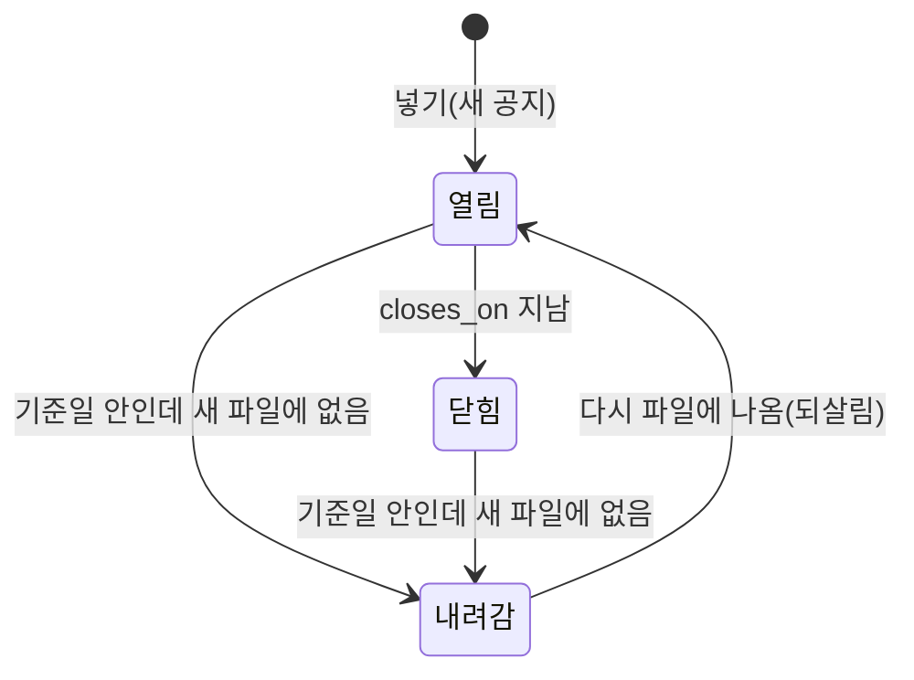

# Data Model: 2단계 백엔드 뼈대

Postgres 17 + pgvector. 표 이름은 영어, 설명은 spec 용어를 쓴다. 학생 자료 표는 모두 `students.id`를 `ON DELETE CASCADE`로 가리켜, 계정을 지우면 한 번에 사라진다(FR-020). 숫자 한도는 research R21(`server/limits.ts`)이다.

## 1. 학생과 로그인

### students(학생)

| 칸 | 꼴 | 규칙 |
|---|---|---|
| id | bigint identity | 내부 학생 번호(FR-009). 앱과 운영자 화면에는 주지 않는다 |
| dept | text | 학과(FR-019). 개발 계정 기본은 '소프트웨어학과' |
| analysis_off | boolean, 기본 false | 나의 분석을 끈 상태(FR-032d) |
| created_at, last_seen_at | timestamptz | |

### login_methods(로그인 수단)

| 칸 | 꼴 | 규칙 |
|---|---|---|
| id | bigint identity | |
| student_id | → students | cascade |
| kind | text | `dev`·`sso`·`test` 중 하나 |
| subject | text | 개발은 소문자 이메일, 통합 로그인은 학교가 주는 고유 값 |
| password_hash | text, 없을 수 있음 | 개발만. `scrypt$N$r$p$솔트$해시` 꼴(R5) |
| failed_count | int, 기본 0 | 잇단 실패 수 |
| locked_until | timestamptz, 없을 수 있음 | 5번 틀리면 지금 + 15분(FR-011) |

`unique(kind, subject)`. 한 학생에 여럿 붙을 수 있다(FR-009).

### sessions(로그인 유지)

| 칸 | 꼴 | 규칙 |
|---|---|---|
| token_hash | bytea, 기본 키 | 토큰의 SHA-256. 토큰 자체는 두지 않는다 |
| student_id | → students | cascade |
| created_at, last_used_at | timestamptz | 유효: `last_used_at + 30일 > now()`(FR-013) |

### consents(동의 기록)

`student_id`(기본 키, cascade), `text_version`(동의한 문구 판), `agreed_at`. 동의 전에는 아래 학생 자료 표에 쓰지 않는다(FR-015). 쓰는 함수마다 먼저 확인한다.

### answers(처음 질문 답)

`student_id`(기본 키, cascade), `grade`(1~4, 4는 4학년 이상), `term`(1·2), `goal`(`job` 취업·`grad` 대학원·`startup` 창업·`unsure` 아직 모름), `answered_at`(FR-016).

### student_fields(고른 분야)

`student_id`(cascade), `field_id`, `picked_at`. 기본 키는 (student_id, field_id). 지금 분야 목록에 있는 세부 분야만 받고, 저장 함수가 3개 이상인지 본다(FR-017). 목록이 바뀌어 사라진 분야는 넣기가 지운다(FR-008).

## 2. 분야 목록

### taxonomies

| 칸 | 꼴 | 규칙 |
|---|---|---|
| id | text, 기본 키 | 1단계 목록 id(`custom`·`ncs`·`csrankings`) |
| name, edition | text | 이름과 목록 판(1단계 파일의 `edition`) |
| chosen | jsonb, 없을 수 있음 | 1단계 `Chosen`(고른 날, 핵심 정밀도, 지시문, 모델). 운영 모드는 이것이 있어야 넣는다(FR-003) |
| active | boolean | 지금 쓰는 목록. 많아야 하나(부분 unique 색인) |
| loaded_at | timestamptz | |

### field_groups

`taxonomy_id`, `id`, `name`, `parent_id`(없을 수 있음), `ord`. 기본 키는 (taxonomy_id, id).

### fields(세부 분야)

`taxonomy_id`, `id`, `name`, `group_id`, `description`(한 줄 설명), `ord`, `vector vector(1024)`(없을 수 있음, 1단계 글 규칙 '묶음 > 이름: 설명'). 기본 키는 (taxonomy_id, id).

## 3. 공지와 판정 검토

### notices(공지)

칸의 값은 학생에게 보이는 값이다(research R22). 결과 파일의 값은 `file`에 그대로 두고, 사람 판정이 있는 칸은 사람 판정이 이긴다.

| 칸 | 꼴 | 규칙 |
|---|---|---|
| id | text, 기본 키 | 결과 파일의 id 그대로(출처와 글 번호) |
| source | text | 출처 |
| title, url | text | |
| posted_on | date | 게시일(한국 날짜) |
| host | text, 없을 수 있음 | 주최 |
| is_notice | boolean | 학생에게 보이는 공지인가. 결과 파일의 기회는 참, 확인 필요 글은 거짓으로 들어오고(FR-004) 운영자가 바꿀 수 있다 |
| kind | text, 없을 수 있음 | 종류(확인 필요 글은 운영자가 넣기 전까지 없음) |
| deadline | date, 없을 수 있음 | 마감 |
| field_state | text | `off`(결과 파일에 분야 목록 머리 없음) · `missing`(머리는 있는데 이 글에 분야 칸 없음) · `judged`(분야 칸 있음, 비어 있어도) · `human`(운영자가 정함) |
| field_rule | text, 없을 수 있음 | 분야 근거. 'LLM: <모델 이름>' 또는 '운영자' |
| closes_on | date, 계산 칸 | `coalesce(deadline, posted_on + 30)`(FR-021). 보이는 마감으로 계산한다 |
| search_text | text | 제목+주최를 소문자로, 공백 없이(R12) |
| vector | vector(1024), 없을 수 있음 | 1단계 글 규칙. 본문 칸은 없다(FR-006) |
| down | boolean, 기본 false | 내려간 공지(FR-005) |
| file | jsonb | 결과 파일의 그 줄 그대로(판정, 종류, 마감, 근거, 분야). 운영자 화면이 '파일 값'으로 보여 준다. 본문은 원래 없다 |
| file_hash | text | `file`의 해시. 같으면 '바뀜 0' |
| first_seen_at, updated_at | timestamptz | |

**열린 공지** = `is_notice`이고, 내려가지 않았고, `closes_on`이 오늘(한국) 이후다.

### notice_fields(공지 분야)

`notice_id`(cascade), `field_id`, `level`(`core`·`related`), `ord`. 기본 키는 (notice_id, field_id). 핵심 2개·관련 5개까지, 서로 겹치지 않음(넣기와 운영자 고치기가 검사). 학생에게 보이는 분야다(사람 판정이 있으면 그 값).

### review_items(확인할 것)

`notice_id`(기본 키), `reasons text[]`, `checked_by`, `checked_at`(없으면 아직 확인 안 함). 넣을 때마다 이유를 다시 계산하고, 이유가 같으면 확인 상태를 둔다(FR-050). 이유가 없어진 공지는 행을 지운다.

| 이유 | 붙는 때 |
|---|---|
| `review:<분류기 이유>` | 확인 필요 글 |
| `no_deadline` | 기회인데 마감이 없음(사람 판정으로 마감을 넣었으면 붙지 않음) |
| `no_fields` | `field_state`가 `missing`이거나, `judged`인데 핵심·관련이 모두 빔. `off`일 때는 붙지 않는다(research R11) |

### human_verdicts(사람 판정)

`notice_id`(cascade), `field`(`is_notice`·`kind`·`deadline`·`fields`), `value jsonb`(분야는 `{core, related}`), `by_operator`, `at`. 기본 키는 (notice_id, field). 넣기는 사람 판정이 있는 칸의 보이는 값을 결과 파일 값으로 바꾸지 않는다(FR-052).

### verdict_log(고친 기록)

`id`, `notice_id`, `field`, `action`(`edit`·`confirm`·`rejudge`), `old jsonb`, `new jsonb`, `by_operator`, `at`(FR-053). 지우지 않는다.

### rejudge_marks(다시 판정 표시)

`notice_id`(기본 키), `by_operator`, `at`. 다음 매일 작업이 분류기를 돌리기 전에 그 글의 보관 답을 지우고, 넣은 뒤 표시를 지운다(FR-054, R11).

## 4. 학생 행동과 글

### actions(카드 행동)

| 칸 | 꼴 | 규칙 |
|---|---|---|
| student_id | → students | cascade |
| notice_id | → notices | 공지는 지우지 않고 내려가기만 한다 |
| kind | text | `like` 관심 있어요 · `later` 나중에 보기 · `dislike` 관심 없음 |
| revisit_on | date, 없을 수 있음 | `later`만. 내일부터 `closes_on`까지(FR-026) |
| reason | text, 없을 수 있음 | `dislike`만: `time`·`field`·`done`·`hard` 또는 없음(FR-025) |
| at | timestamptz | 정한 때. 두 기기가 엇갈리면 나중에 받은 것 |

기본 키는 (student_id, notice_id). 지금 상태만 둔다.

### prompts(나에 대한 프롬프트)

`student_id`(기본 키, cascade), `body`(1,000자까지), `vector`(없을 수 있음, 다음 매일 작업에 다시 만듦), `updated_at`(FR-028).

### activities(직접 넣은 활동)

`student_id`(cascade), `id`(identity), `name`(100자까지), `term`(`YYYY-1`·`YYYY-2`), `kind`(공지 종류 목록), `field_ids text[]`(지금 목록에 있는 0~2개), `proof_url`(없을 수 있음), `created_at`, `updated_at`. 학생마다 100개까지(FR-030).

### excluded_lines(뺀 줄)

`student_id`(cascade), `line_key`, `at`. 기본 키는 (student_id, line_key). 직접 넣은 활동 줄, 처음 답, 고른 분야는 빼지 않는다(FR-032c).

### analyses(나의 분석)

| 칸 | 꼴 | 규칙 |
|---|---|---|
| student_id | 기본 키 | cascade |
| version | int | md가 실제로 바뀔 때만 +1(FR-032a) |
| made_at | timestamptz | |
| lines | jsonb | 사실 줄 `[{ key, section: done/interest, text, source, proof }]` |
| flow | jsonb | 흐름 `[{ key, text, refs }]`(R10) |
| flow_version | int, 없을 수 있음 | 흐름을 쓸 때의 판. `version`보다 작으면 다음 매일 작업이 흐름을 쓴다 |
| md | text | 뺀 줄을 뺀 사실 줄과 흐름으로 만든 글 |

분석을 끄면 이 행과 뺀 줄을 지운다(FR-032d).

### picks(가장 추천)

`student_id`(기본 키, cascade), `notice_id`, `reason`, `cited jsonb`(`[{ key, text }]` 또는 `[{ key: 'prompt' }]`, 0~3개), `analysis_version`, `method`(`llm:<모델 이름>`·`rule`), `prompt_version`, `computed_at`(FR-036).

### repick_queue(다시 고르기 줄)

`student_id`(기본 키, cascade), `queued_at`, `cause`. 학생마다 한 행이라 밀린 것이 하나로 합쳐진다(FR-037). 행이 있으면 홈에 '새로 고르는 중'이다.

## 5. 운영 기록

- **ingest_runs**(넣기 기록): `id`, `at`, `source`, `collected_at`, `since`, `taxonomy_id`, `taxonomy_edition`, `summary jsonb`(FR-007), `rejected`(거절 이유, 없을 수 있음).
- **daily_runs**(매일 작업 기록): `id`, `started_at`, `ended_at`, `steps jsonb`, `load jsonb`(FR-045).
- **schema_migrations**: `name`(기본 키), `applied_at`(R4).

## 6. 상태 변화

- **다음 할 일**(FR-018): 동의 → 처음 질문 → 분야 고르기(고른 분야가 3개 미만이면 다시) → 홈.
- **카드 행동**: 없음 → 관심 있어요·나중에 보기·관심 없음 중 하나. 새 행동이 앞 행동을 바꾸고, 지우기로 없음이 된다.
- **가장 추천**: 없음 → 규칙 또는 LLM. 재료가 바뀌면 줄에 들어가 '새로 고르는 중'이 되고, 끝나면 새 값이 된다. 앞의 가장 추천이 닫혔거나 내려갔거나 학생이 행동했으면, 홈을 열 때 규칙 1위로 바로 바꾼다(FR-038).

## 7. 밖으로 주지 않는 것

- 앱에 주지 않는다: `students.id`, 규칙 점수, 벡터 유사도(FR-024), 세션·비밀번호 칸, 다른 학생의 자료.
- 운영자 화면에 주지 않는다: 1·4절의 학생 표 전부(FR-055).
- 서버 기록과 요약에 남기지 않는다: 비밀번호, 토큰, 프롬프트, 분석 글, 활동 이름, 공지 본문(FR-047).
